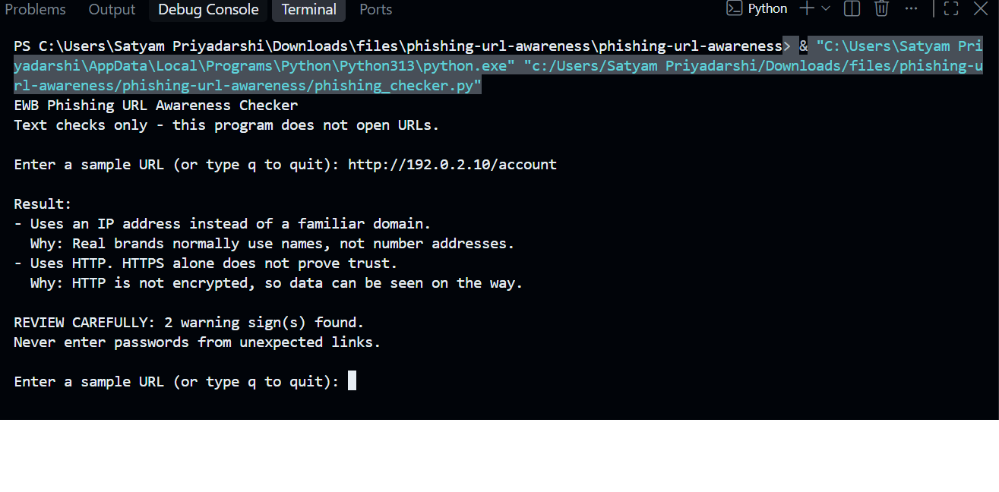
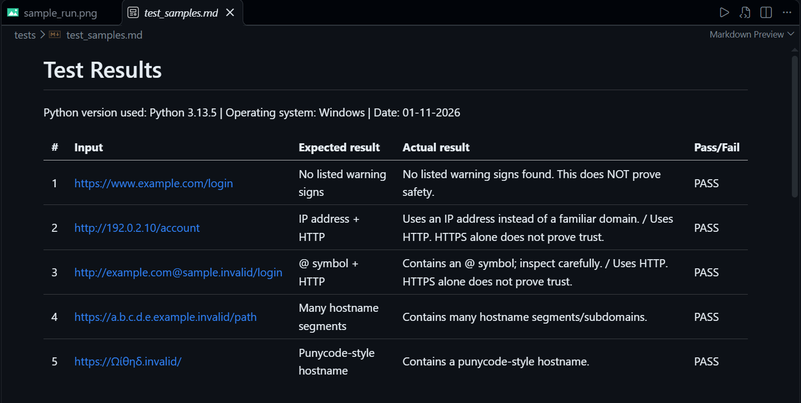

# EWB Phishing URL Awareness Checker

## Overview
Phishing is a trick where fake links or messages try to make people share passwords, card numbers or OTPs. This tool reads the text of a URL and points out six visible warning signs. It never opens the URL or sends anything over the internet.

## Features
- Detects an @ symbol in the URL
- Flags unusually long URLs (over 100 characters)
- Flags IP-address hostnames
- Flags many hostname segments (5 or more)
- Flags punycode-style hostnames (xn--)
- Flags the HTTP scheme
- Loop mode: check many URLs in one run, type q to quit
- Simple reason printed under every warning, plus a "REVIEW CAREFULLY" summary
- Malformed input (like `http://[bad`) is handled without crashing

## Requirements
Python 3.10 or later. No extra packages.

## How to Run
Windows: python phishing_checker.py
Mac/Linux: python3 phishing_checker.py

## Example Output
```
EWB Phishing URL Awareness Checker
Text checks only - this program does not open URLs.

Enter a sample URL (or type q to quit): http://192.0.2.10/account

Result:
- Uses an IP address instead of a familiar domain.
  Why: Real brands normally use names, not number addresses.
- Uses HTTP. HTTPS alone does not prove trust.
  Why: HTTP is not encrypted, so data can be seen on the way.

REVIEW CAREFULLY: 2 warning sign(s) found.
Never enter passwords from unexpected links.
```

## Testing
| # | Input | Expected | Actual | Result |
|---|-------|----------|--------|--------|
| 1 | https://www.example.com/login | No warning signs | No listed warning signs found | PASS |
| 2 | http://192.0.2.10/account | IP address + HTTP | IP address + HTTP warnings | PASS |
| 3 | http://example.com@sample.invalid/login | @ symbol + HTTP | @ symbol + HTTP warnings | PASS |
| 4 | https://a.b.c.d.e.example.invalid/path | Many hostname segments | Many hostname segments warning | PASS |
| 5 | https://xn--example.invalid/ | Punycode-style hostname | Punycode-style hostname warning | PASS |

Full table is in tests/test_samples.md

## Screenshots



## Improvements
1. Loop with quit - the program now keeps asking for URLs until the user types q, so there is no need to restart it. Tested by entering several URLs in one run, then q.
2. Safer parsing - `http://[bad` used to crash with a ValueError. A try/except now prints "This text is not a valid URL format." Tested with that exact input.
3. Reasons and summary - every warning now has a one-line reason, and a "REVIEW CAREFULLY" line shows the number of warnings. After these changes all five tests were run again and still passed.

## Limitations
This is an educational tool. It only reads URL text. It does not visit
URLs, scan for malware or prove that a URL is safe. No warning signs
found does NOT mean a URL is safe.

## Ethical Use
Use sample strings only. Do not collect credentials. Do not use this
project to deceive anyone or to test websites without permission.

## Author
Satyam Priyadarshi, AI-Powered Cybersecurity Internship, EWB Courses
